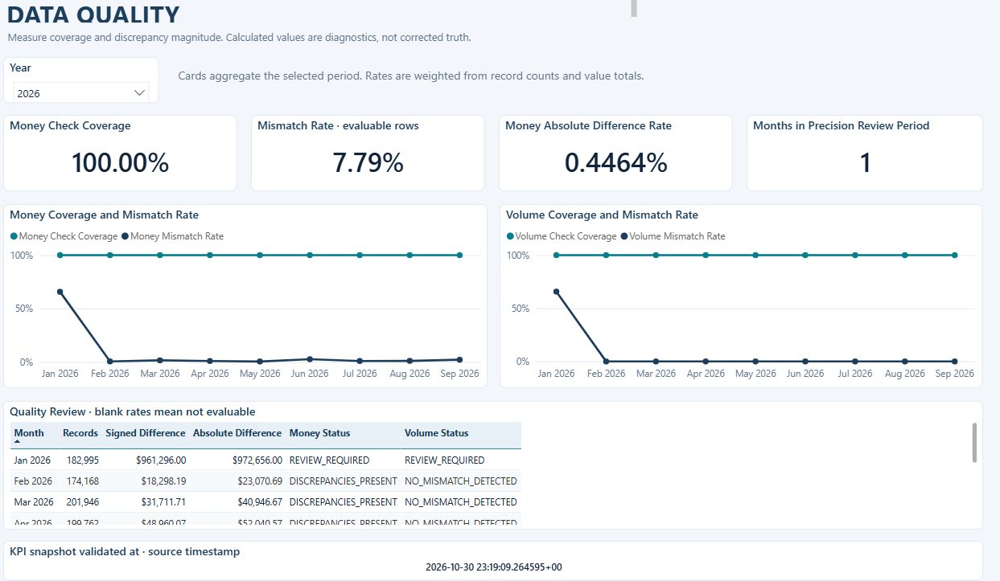
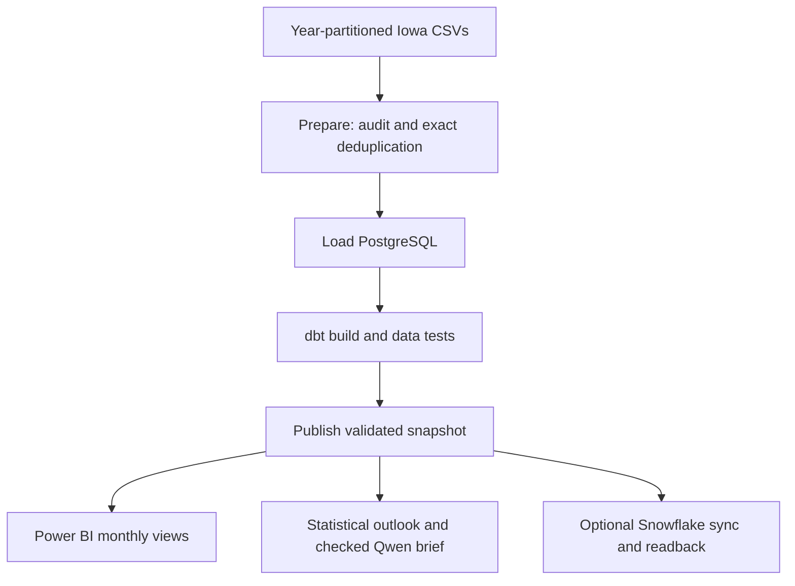

# Retail Distribution Intelligence

In January 2026 the Iowa source reported $28.56 million in distribution sales. Every record could be checked, yet the sum of absolute differences between reported and calculated amounts was **$972,656**. A dashboard that only shows totals hides that distinction. This project keeps the original amounts, flags months that need review, and carries those caveats into a monthly brief.



The warehouse contains **17,337,629 deduplicated records** of Iowa distribution activity. These are purchases by licensed retailers, not consumer checkout sales. The published history spans **81 months, January 2020–September 2026**. The Snowflake monthly mirror stores one aggregate row per month per snapshot.

## Try the fixture in a fresh checkout

From the repository root with Python 3.11 or 3.12, run:

```sh
python scripts/inspect_snapshot.py --year 2026 --files data/fixtures/transactions.csv --output artifacts/demo-manifest.json
python -m unittest discover -s tests -v
```

This path needs no warehouse, credentials, Ollama model or raw downloads. It inspects a synthetic CSV; the full warehouse and dashboard evidence below comes from a separate local installation.

## From source files to a published month



Airflow runs on demand. Report and cloud sync depend on the publication from their own run. Power BI refreshes separately. The [six-task run](docs/images/airflow-run.png) succeeded in 7m 17s on an unchanged input; that duration is not a benchmark for a fresh 17-million-row load.

## Forecast and reporting results

A rolling one-month-ahead replay on **January–September 2026** uses only months preceding each target. Both methods predict statewide net bottles. MAE is mean absolute error in bottles; WAPE divides total absolute error by total absolute actual bottles.

| Method | Scored months | MAE (bottles) | WAPE |
|---|---:|---:|---:|
| Seasonal naive (same month last year) | 9 | 54,167.67 | 2.2133% |
| Damped additive Holt-Winters | 9 | 65,937.69 | 2.6942% |

Seasonal naive remains the primary plan: Holt-Winters did not improve on it in this window. These are reconstructions using one data vintage, not predictions recorded before each sale. Install NumPy and SciPy (`python -m pip install numpy==2.2.6 scipy==1.15.3`) and run `python scripts/backtest_monthly.py` to replay the [published monthly inputs](docs/evidence/monthly-evidence.json).

Qwen 2.5 3B runs locally through Ollama. Policy controls the lead, protected fields come from source facts, and validators check numbers, direction and required caveats before rendering. In the [three-month evaluation](docs/evidence/evaluation.json), both the deterministic baseline and Ollama passed **3/3**. This is a small contract test, not a general accuracy claim. Read the [September brief](docs/evidence/brief.md).

## Explore or reproduce

- [Two-minute demo, screenshots and run evidence](docs/acceptance/RUN_EVIDENCE.md)
- [Data source and attribution](docs/data_sources.md) · [data contract](docs/data_contract.md)
- Full installation: [dbt](README_DBT.md), [publication](README_PUBLICATION.md), [snapshot ingestion](README_SNAPSHOTS.md), [Airflow setup](README_AIRFLOW.md), [AI reporting](docs/AIRFLOW_REPORTING.md), [optional Snowflake branch](docs/AIRFLOW_SNOWFLAKE.md)
- [CI and release procedure](docs/RELEASE.md) · [deferred failure drills](docs/STRESS_FAIL_TESTS.md)

Data completeness is unverified. Recalculated sales are diagnostics, not corrections. Missing coverage is not a zero mismatch rate. Store-level ML/DL experiments are archived comparisons, not components of the published forecast.
