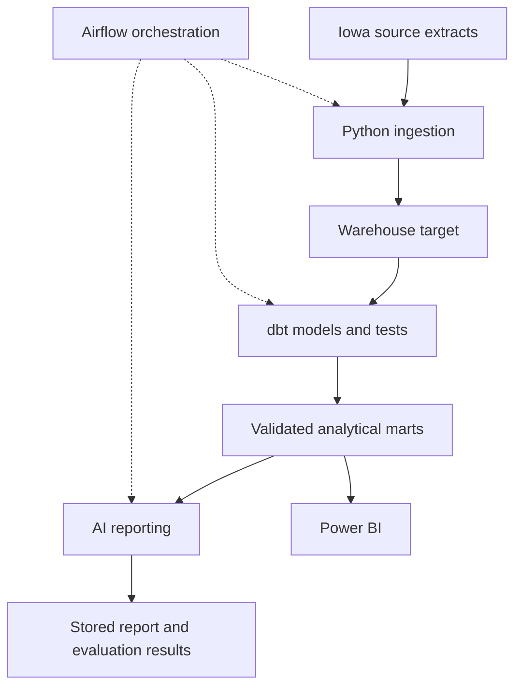

# Retail Distribution Intelligence — Architecture Baseline

> Historical design record. The [implemented architecture](architecture.md), [run evidence](acceptance/RUN_EVIDENCE.md) and [forecast evaluation](../README.md#forecast-and-reporting-results) supersede older implementation-status statements below.

**Version:** 1.4  
**Decision date:** 2026-10-22  
**Owner:** Huy Vu  
**Repository/project directory:** retail-distribution-intelligence  
**Document role:** Canonical architecture and scope baseline for subsequent implementation and review.

## 1. Purpose and authority

Build a portfolio project demonstrating Data Engineering and AI Automation through a reproducible retail/distribution analytics workflow, with measurable data quality and grounded AI reporting.

This baseline records decisions explicitly confirmed in the project conversation. It distinguishes the required target architecture from the implementation already demonstrated. It is not a claim that every component is complete.

Before proposing a next step or editing the project:
1. Read this document and inspect the latest repository state.
2. Preserve every required component unless the owner explicitly changes scope.
3. Separate confirmed observations, implementation proposals and unresolved decisions.
4. Do not invent repository contents, successful executions, credentials, evaluations or deployment results.
5. Update this document and its change log when an approved decision changes.

All project code comments, documentation, report labels and generated business reports are to be written in English. Conversation and explanations may be in Vietnamese.

## 2. Required project scope

All components below are part of the completion scope. They must not be silently omitted or demoted to optional additions.

| Component | Required responsibility | Current evidence/status |
| --- | --- | --- |
| Python | File discovery, inspection, ingestion, exact deduplication and source lineage | Full-snapshot preparation/replacement supplied in step 10B; local end-to-end refresh pending |
| PostgreSQL | Local development warehouse and reference implementation | Running in Docker; user demonstrated loading and analytical queries |
| dbt | Transformation models, dependencies, tests, documentation and lineage | Local dbt completion and 27 publication data-test results supplied; source-bound build evidence added in 10B |
| Apache Airflow | Workflow dependencies, scheduling, retries, failure tracking and recovery | Local four-task DAG supplied; Docker runs and recovery evidence pending |
| Snowflake | Actual cloud warehouse implementation and execution evidence | Required; no account setup or successful cloud run demonstrated |
| AI reporting | Evidence-grounded narrative reports from validated aggregate outputs | Required; no reporting pipeline or evaluation demonstrated |
| Power BI | Interactive reporting and inspection of business/data-quality results | Three-page template created; user confirmed it works |
| Tests and CI | Small-fixture checks, regression coverage and automated verification | Existing SQL controls exist; full project test/CI workflow remains pending |

PostgreSQL is the established local environment. Do not substitute DuckDB without an explicit scope decision.

Snowflake is a required final deliverable. An unavailable account or budget is a blocker to track, not a reason to claim completion or remove it from scope.

## 3. Target architecture

The following diagram describes the TARGET system, not the current implementation.



Warehouse target has two required implementations:
- PostgreSQL for local development and reference results.
- Snowflake for cloud execution and verified results.

This does not imply that both warehouses must run in series on every execution. The transfer/loading mechanism for Snowflake is still to be designed.

Airflow calls ingestion, dbt and reporting tasks. Do not build a competing custom Python orchestration framework. A small CLI for invoking tasks may exist, but Airflow owns workflow coordination.

Python handles ingestion and source-record identity. dbt handles SQL transformations. Infrastructure migrations retain responsibility for database/schema creation, roles and permissions.

Power BI consumes the independent monthly publication; user-provided logs and screenshots confirm step 10A publication and refresh. Step 10B supplies repeatable full-source preparation/replacement and source-bound dbt build evidence; its local end-to-end refresh still requires verification. AI reporting will consume the validated publication later.

## 4. Data and business interpretation

Source: Iowa Liquor Sales extracts. The project uses available 2020–2026 data; the reviewed snapshot extends through September 2026. Do not label 2026 as a complete year.

Treat the dataset as distribution sales/purchases involving licensed stores. Do not present it as individual consumer checkout behavior.

The source contains 23 business columns:

```text
invoice_id, ordered_on, store_no, store_name, store_address,
store_city, store_zip_code, county_fips_code, county_name,
category_code, category_name, vendor_number, vendor_name,
item_no, im_desc, pack, bottle_volume_ml, state_bottle_cost,
state_bottle_retail, sales_bottles, sales_dollars,
sales_liters, sales_gallons
```

### Identity and deduplication contract

- Remove exact duplicate records by comparing all 23 source field values under the existing audit policy.
- Check duplicates across files and year folders, not only within individual files.
- Preserve same-invoice records with different contents.
- invoice_id is NOT the fact primary key.
- Do not assume invoice_id plus item_no is unique.
- _audit_row_id identifies a record within the current deduplicated export; it is not guaranteed stable across rebuilt exports.
- Retain source extracts and lineage. Do not silently normalize business values while deciding exact identity.
- Handling changed source files and upstream corrections requires an explicit policy before incremental updates are implemented.

## 5. Confirmed implementation baseline

User-provided execution output demonstrated:
- PostgreSQL image: postgres:17-bookworm.
- Service: postgres.
- Database: retail_analytics.
- Host endpoint: localhost:5433; container PostgreSQL port: 5432.
- Host binding: 127.0.0.1.
- Schemas: raw, staging, marts, ops.
- Loaded deduplicated records: **17,337,629**.
- Fact records after migration 006: **17,337,629**.
- Store dimension: **2,862** records.
- Product dimension: **10,858** records.
- Date dimension: **2,464** records.
- Migration 006 committed with preservation_check = PASSED.
- Monthly KPI query after 007 produced the reviewed results.
- User subsequently confirmed the Power BI report works.

Do not infer that the raw schema is populated merely because it exists. The demonstrated PostgreSQL load target is staging.iowa_sales_exact, populated from the deduplicated export.

Existing logical layers:
1. staging.iowa_sales_exact — source business values retained as text plus audit ID.
2. staging.iowa_sales_typed — typed values, missing-field flags and invalid-field flags.
3. staging.iowa_sales_reconciled — reported/calculated values, differences and diagnostic flags.
4. marts.fact_sales, dim_store, dim_product, dim_date — materialized analytical snapshot.
5. marts.sales_monthly and v_sales_monthly_kpis — monthly snapshot and derived KPI view.
6. marts.bi_sales_monthly — scalar-column contract for Power BI.
7. ops and marts audit objects — execution/quality/preservation evidence.

Existing migrations 006 and 007 are initial snapshot builds. They deliberately refuse to overwrite existing objects. Do not instruct the user to rerun them as a refresh mechanism.

### Dimension policy

Store and product dimensions use the latest observed complete row of attributes for each natural code. Selection orders by date descending, then audit ID for a deterministic within-export tie-break. Missing attributes in that chosen row remain missing.

This is not SCD Type 2 history. Latest dimension attributes must not be described as transaction-time history. Fact records retain observed descriptive attributes, category, vendor and pricing context.

## 6. Immutable reporting principles

1. Preserve source-reported measures.
2. Keep calculated measures as separate diagnostic estimates.
3. Never overwrite reported values merely to force arithmetic consistency.
4. Missing prices remain NULL, not zero.
5. Negative measures remain available and flagged; do not automatically label every negative record a return.
6. Decimal calculations use suitable decimal types; do not cast money/volume to integers.
7. Pipeline-preservation PASSED does not certify business correctness or extract completeness.

Calculation contract:
- calculated_sales_dollars = sales_bottles * state_bottle_retail.
- calculated_sales_liters = sales_bottles * bottle_volume_ml / 1000.
- difference = reported minus calculated.
- mismatch: absolute difference strictly greater than 0.01 USD or 0.01 liter.
- Missing comparison inputs yield a non-evaluable check; do not count it as passing.
- Relative absolute difference uses sum(abs(difference)) / sum(abs(reported)) over the same evaluable records.
- Signed differences can cancel, so retain absolute differences and coverage.

Reviewed findings:
- Monetary reconciliation coverage is absent for the reviewed 2020–2024 period and January–June 2025 because unit-price fields are unavailable.
- November 2025 through January 2026 is the established precision-review period.
- Reviewed monthly absolute monetary differences in that period are approximately 3.0–3.4% of absolute reported value.
- A high mismatch-row percentage is not the same as an equally high sales-error percentage.
- The source-versus-calculated disagreement does not prove which operand is wrong.
- Period completeness remains UNVERIFIED until independently established.

Do not add profit, consumer/customer counts, average order value, stock availability or causal business explanations without adequate data and explicit definitions.

## 7. Power BI contract

Existing report pages:
- Sales Overview.
- Growth Analysis.
- Data Quality.

The current report imports the monthly BI view through the dedicated retail_bi login. It does not require importing the full fact table.

Behavior:
- Overview cards show the selected KPI month, or latest available month within the current selection.
- The month slicer does not remove annual context from the Overview trend/table.
- Active store counts are monthly distinct counts and must not be added across months.
- Rates across selected months are recomputed from summed numerators/denominators, not averaged from monthly percentages.
- YoY matches the exact calendar month one year earlier.
- A monthly YoY measure is not automatically an annual/YTD growth measure.
- Preserve comparison caveats, including problems in the prior-year period.

Power BI Refresh reads existing database snapshots. It does not run ingestion, dbt or rebuild marts. Cloud-service publishing and scheduled Power BI refresh have not been confirmed.

Store/product drill-down requires appropriately grained data; the current monthly view cannot support it alone.

## 8. Agreed implementation order

### Step 9 — dbt migration: USER-REPORTED LOCAL COMPLETION

Inspect the latest repository, then move existing transformation logic into dbt models:
- Typed and reconciled staging transformations.
- Dimensions and fact.
- Monthly KPI models and BI-compatible outputs.
- Explicit sources, descriptions, dependencies and tests.

Preserve the existing BI contract or provide a controlled compatibility layer. Keep role/schema setup separate from dbt transformations.

Classify failures:
- Structural/preservation failures that block publication.
- Source-quality findings that remain visible as warnings/review states.

Do not mark every known source discrepancy as a pipeline failure, and do not silently downgrade structural failures to warnings.

### Step 10 — Repeatable ingestion and snapshot publication (IN PROGRESS)

Step 10A is demonstrated locally: publication run
`13b211bf-0b94-40fa-86e4-46258183d941` produced snapshot
`17344d4b-961e-4f23-b0e5-9eca35033df7`. The user supplied 27 data-test results
(26 PASS, one expected WARN for 81 months) and Power BI refresh screenshots.
Publication replay is now demonstrated: run `5e6bc320-b7ff-4493-95c0-2f6091de0ab4`
published snapshot `bae8dc30-62b6-4d3d-9368-f7d3b57f7163`; run
`bd1d1d3a-0d02-4fd6-a7ea-1ef8bf0933ae` reran the tests and returned
UNCHANGED with that same snapshot. This proves publisher replay for this input.

Step 10B implementation is supplied with separate prepare/load/build/publish
tasks, content fingerprints, retained audit/export bundles, transactional source
replacement, replay detection and source/code-bound full-build evidence.
Python regression tests and embedded PostgreSQL SQL checks passed. Actual
PostgreSQL 17 end-to-end refresh and CI execution remain pending.

The correction policy is complete-snapshot replacement. The active input set must
include all intended years; superseded files are excluded deliberately. Exact
23-field identity remains unchanged. Historical raw file bytes are not copied
into every bundle; retained deduplicated exports and audit lineage enable source
recovery. Retain original extracts separately. No business-key incremental upsert
policy or automatic retention cleanup has been implemented.

Published monthly rows stay independent while source/dbt work changes. Loading,
mutating dbt commands and publication use cooperative warehouse locking. Direct
administrative SQL or raw dbt commands are outside this coordination contract.

### Step 11 — Airflow orchestration

The supplied retail_snapshot_pipeline DAG uses Airflow 3.1.7 / Python 3.12,
LocalExecutor, one active run, manual triggers, and a separate PostgreSQL 16
metadata service. It reuses prepare, load, full dbt build and validated publish.
Each run pins its prepared bundle. The existing PostgreSQL 17 warehouse remains
the source of Power BI's monthly snapshot. See README_AIRFLOW.md.

Demonstrate:
- Successful end-to-end execution.
- Reprocessing the same input without duplicate results.
- Invalid-schema input.
- A failed task and recovery after correction.
- Failed validation leaving the published snapshot usable.

The DAG parsed with Airflow 3.1.7; the adapter passed three fixture tests. Local Docker success, replay and recovery must still be recorded. A calendar schedule is deferred until input arrival and completeness rules are agreed.

### Step 12 — Snowflake implementation

Set up access roles, schemas and compute; load a representative slice first; execute dbt models/tests; compare reference outputs with PostgreSQL; record runtime and compute usage.

Use actual execution evidence. Configuration files or diagrams alone do not complete this requirement. Exact costs, credits, account access and availability have not been established.

### Step 13 — Evaluated AI reporting

Feed the model a bounded, structured KPI/evidence payload with quality flags and period context, not the full fact dataset.

SQL/dbt performs arithmetic. AI produces narrative summaries referencing the supplied evidence. Separate supported observations from hypotheses requiring investigation.

Persist enough information to inspect and reproduce a report:
- Input snapshot/run reference and KPI payload version.
- Prompt/template version and model identity.
- Generated output and supporting metric references.
- Validation results, token usage, latency and cost basis.

Evaluate numerical accuracy, unsupported claims, correct use of quality caveats, token cost and latency on a defined set of reporting cases. Do not claim evaluation results until measured.

Provider/model, prompt design, delivery surface, evaluation thresholds and human review policy are still to be selected. LangChain, LangGraph, RAG and model training are NOT automatic requirements of this retail project.

### Step 14 — CI, business evidence and portfolio packaging

Build meaningful small fixtures and automated checks. Tests should accompany implementation rather than all being postponed until this final step.

Produce:
- Reproducible setup/run instructions.
- Architecture and data-contract documentation.
- dbt lineage/test evidence.
- Airflow execution and recovery evidence.
- Snowflake execution and resource-use evidence.
- AI reporting evaluation results.
- Power BI screenshots/demo and grounded analytical findings.

These are evidence requirements, not claims that the deliverables exist already.

## 9. Open decisions and blockers

- Root configuration, SQL 001–008, ingestion scripts, tests and CI were supplied. The full current src/configs/fixtures tree has not been verified.
- Actual Snowflake account, access and budget are unconfirmed.
- Snowflake loading/staging mechanism is undecided.
- Cross-adapter SQL differences and decimal/date behavior need implementation and verification.
- Publication is demonstrated locally; new-export ingestion/rebuild code is supplied and awaits local PostgreSQL 17 integration evidence.
- Source-file corrections and stable identity across rebuilt exports need a policy.
- The Airflow profile is local and manual; the first Docker run and operator recovery demonstration are pending.
- AI provider/model and evaluation acceptance thresholds are undecided.
- No automatic sending of AI reports to other people is authorized.
- No GitHub push, cloud deployment or CI execution should be inferred from locally generated files.

The separate Personal Financial Assistant project must not be merged into this project's scope.

## 10. Completion criteria

The project is complete only when all required components have implementation and evidence:
- Repeatable ingestion, validated transformations and recoverable updates.
- dbt models/tests/docs.
- Executed Airflow workflow with a demonstrated failure/recovery case.
- Executed Snowflake path with comparison evidence.
- AI reporting with measured evaluation, cost and latency.
- Working Power BI report with honest quality context.
- CI and reproducible documentation.

No tool-name checklist substitutes for a demonstrated workflow. No unexecuted component is described as completed.

## 11. Change log

| Version | Date | Decision |
| --- | --- | --- |
| 1.4 | 2026-10-31 | Recorded the local publication replay and supplied the Airflow integration. No scope change; Snowflake execution, evaluated AI reporting and CI evidence remain required. |
| 1.3 | 2026-10-31 | Recorded actual publication/Power BI evidence and supplied full-source refresh with build provenance and cooperative locking. PostgreSQL 17 end-to-end refresh remains pending; mandatory stack unchanged. |
| 1.2 | 2026-10-24 | Recorded user-reported dbt completion. Supplied step 10A monthly publication and recovery with explicit test evidence; step 10B ingestion and the remaining mandatory stack stay in scope. |
| 1.1 | 2026-10-23 | Supplied isolated PostgreSQL dbt migration and CI fixtures; static validation passed, runtime verification pending. Existing BI publication preserved; required stack unchanged. |
| 1.0 | 2026-10-22 | Recorded required Python + PostgreSQL + dbt + Airflow + Snowflake + AI reporting + Power BI scope; corrected the earlier plan that omitted required components; established dbt as the next implementation step. |

Future updates must identify what changed, why, whether the owner approved a scope change, and what execution evidence supports any status change.

