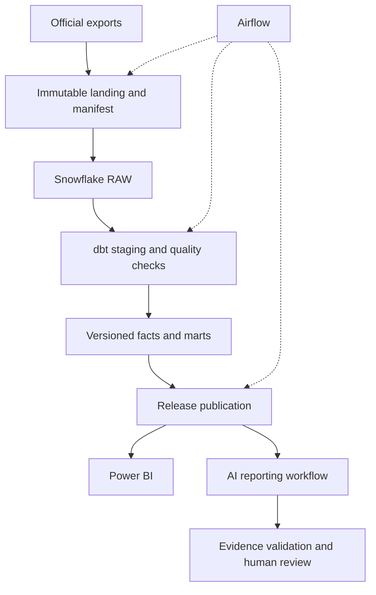

# Target architecture

Status: design, not a deployment diagram of running services.

## Responsibilities

Python receives and inventories source files. Snowflake owns analytical storage. dbt owns transformations and data tests. Airflow owns data dependencies, retries and backfills. LangGraph will own report state and human review, not replace warehouse orchestration. PostgreSQL is a candidate for application state if persistence is needed.

## Publication consistency

Build a candidate release against immutable snapshot references. Validate before updating the active-release pointer. Consumers resolve and retain the release ID at the beginning of report generation; a pointer change must not mix versions inside a report. Implement a transactional publication mechanism and concurrency handling before production use.

## Local/cloud split

The offline inspector is implemented. No credentials are needed for fixtures. Snowflake account setup, least-privilege roles, cost controls and actual integration checks are M2 work. No warehouse DDL or service containers are claimed as operational in this scaffold.

## Source cadence

Design around periodic source releases. A scheduled check may find no new data. Do not label this as real-time CDC. Historical replay is a test technique and must be labeled as such.
