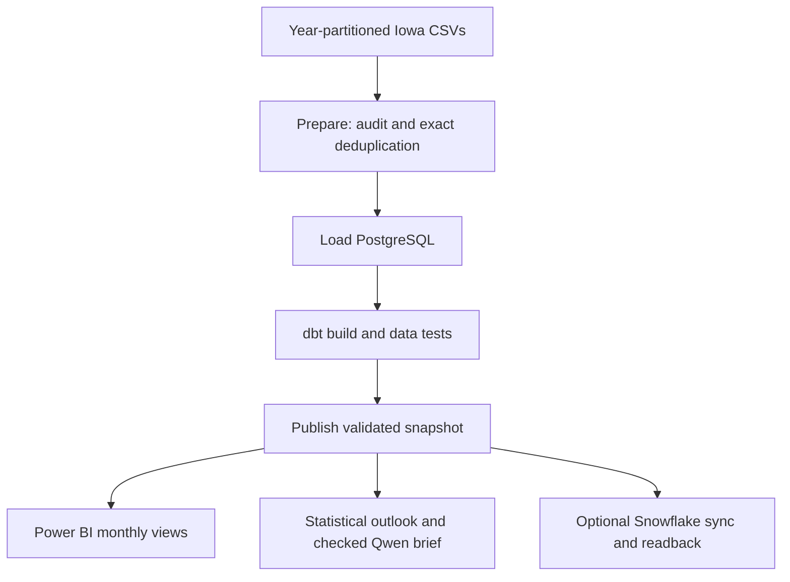

# Implemented architecture

Airflow runs on demand. Report and cloud sync depend on the publication from their own run. Power BI refreshes separately. The [six-task run](docs/images/airflow-run.png) succeeded in 7m 17s on an unchanged input; that duration is not a benchmark for a fresh 17-million-row load.

PostgreSQL is the system of record. See the [acceptance record](acceptance/RUN_EVIDENCE.md) for observed runs.
